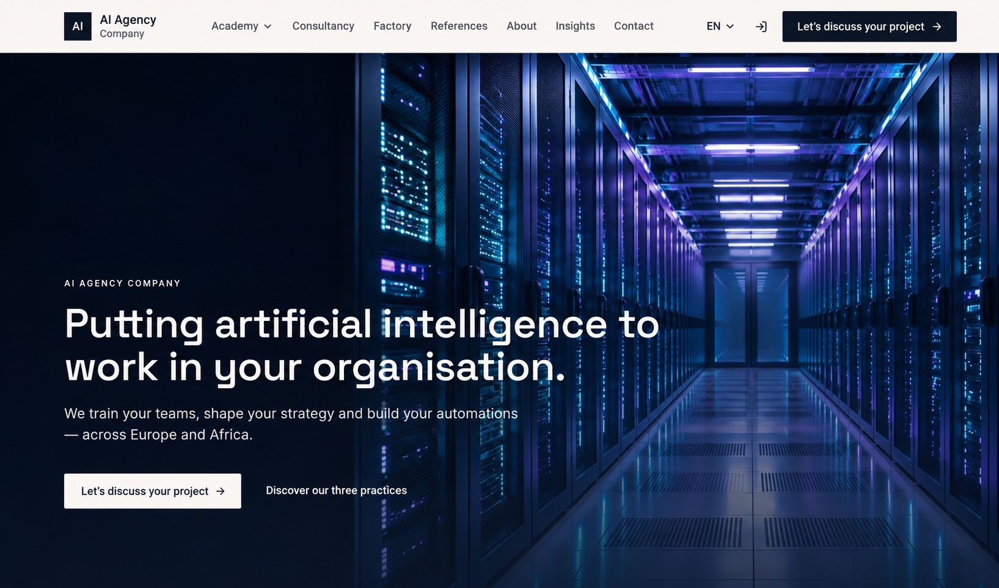

# AI Agency Company — Belgium platform — product case study

## At a glance

- **Product:** AI Agency Company — Belgium platform
- **Website:** [https://aiagencybelgium.be/en](https://aiagencybelgium.be/en)
- **Audience:** Organisations looking to develop AI skills, define an adoption strategy or build practical automations.
- **Focus:** One multilingual platform for AI skills, adoption and practical solutions across Europe and Africa.
- **Format:** Product design and workflow case study, without client-identifying records or measured performance claims.

## The challenge

AI services can be difficult to navigate when training, strategy and implementation are presented as disconnected offers. Visitors need a clear route from their business need to an appropriate service, while a broad training catalogue must remain searchable and understandable.

## The product approach

The platform organises AI Agency Company around three practices: Academy, Consultancy and Factory. The website combines a multilingual service presentation with course discovery, learning journeys, programme requests and contact routes. The structure reflects a business working across Europe and Africa.

- **Academy.** Explore training courses and learning journeys by need, tool, role or theme.
- **Consultancy.** Understand the offer for AI diagnosis, use-case prioritisation and adoption roadmaps.
- **Factory.** Discover custom tools, agents and automation services.
- **Multilingual discovery.** Navigate content in English, French and Dutch.
- **From exploration to enquiry.** Search published training content, request programme information and contact the team.

## Example workflow

This is an illustrative product journey, not a report about a named customer.

1. Start from a business need: skills, adoption strategy or implementation.
2. Explore the relevant practice and its service or training content.
3. For training, search the catalogue or browse by theme and role.
4. Request further programme information or contact the team to discuss the next step.

## Why this approach matters

The intended value is a more coherent discovery journey. A visitor can understand the relationship between learning, adoption and implementation, then move towards a relevant conversation through the same platform.

## Design choices and boundaries

A public service platform needs editorial consistency across languages and a clear separation between visitor content and administration. This showcase presents the public experience only; it contains no CMS access, backend functions, configuration or customer data.

The showcase explains the product experience and its intended usefulness. It does not establish independently measured time savings, revenue impact, customer adoption or compliance certification. Access to operational features may require an authorised account.

## Visual overview

*Public English homepage presenting AI Agency Company and its positioning across Europe and Africa. This image was retouched from a real capture for presentation and privacy; it is not a pixel-exact record.*

## Continue the conversation

[Explore the website](https://aiagencybelgium.be/en) or [contact Vincent Becker](mailto:vincent@aiagency.company) to discuss the product or a related business need.
