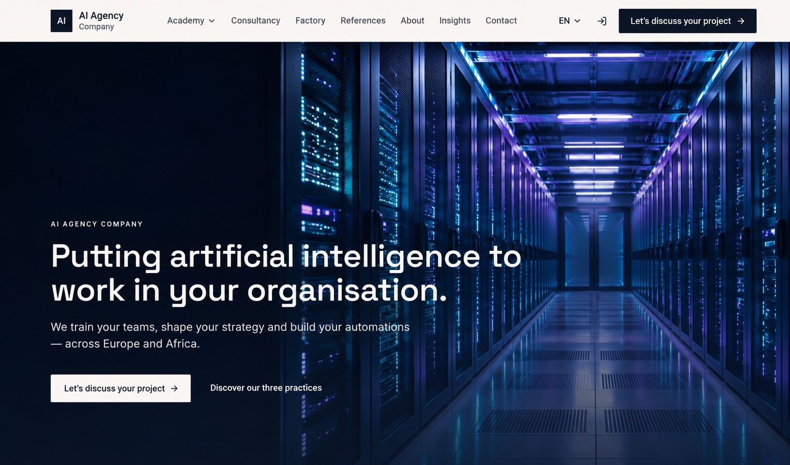

# AI Agency Company — Belgium platform

**One multilingual platform for AI skills, adoption and practical solutions across Europe and Africa.**

[Visit the website](https://aiagencybelgium.be/en) · [Read the case study](CASE_STUDY.md) · [Discuss a project](mailto:vincent@aiagency.company)

*Public English homepage presenting AI Agency Company and its positioning across Europe and Africa.*

## The product

The platform organises AI Agency Company around three practices: Academy, Consultancy and Factory. The website combines a multilingual service presentation with course discovery, learning journeys, programme requests and contact routes. The structure reflects a business working across Europe and Africa.

**Who it is for:** Organisations looking to develop AI skills, define an adoption strategy or build practical automations.

## What it brings together

- **Academy.** Explore training courses and learning journeys by need, tool, role or theme.
- **Consultancy.** Understand the offer for AI diagnosis, use-case prioritisation and adoption roadmaps.
- **Factory.** Discover custom tools, agents and automation services.
- **Multilingual discovery.** Navigate content in English, French and Dutch.
- **From exploration to enquiry.** Search published training content, request programme information and contact the team.

## Case study

AI services can be difficult to navigate when training, strategy and implementation are presented as disconnected offers. Visitors need a clear route from their business need to an appropriate service, while a broad training catalogue must remain searchable and understandable.

The intended value is a more coherent discovery journey. A visitor can understand the relationship between learning, adoption and implementation, then move towards a relevant conversation through the same platform.

Read the [full product case study](CASE_STUDY.md) for the problem, approach, example workflow and design choices. Benefits described here are intended product value; no measured ROI or performance results are claimed.

## About this repository

This is a public product showcase containing English documentation and a reviewed presentation image. It contains no application source code, deployment configuration, database exports or production history. The product implementation is maintained separately and is not distributed here.

The image is based on a real site capture, retouched with an image-editing tool for presentation and privacy. It is illustrative rather than a pixel-exact or forensic record. See [privacy and image notes](PRIVACY.md).

## Founder and contact

Created under the direction of [Vincent Becker](https://github.com/vincentbecker71), founder of AI Agency Company, operating across Europe and Africa, and creator of the Level Me Up programme.

- Website: [https://aiagencybelgium.be/en](https://aiagencybelgium.be/en)
- Contact: [vincent@aiagency.company](mailto:vincent@aiagency.company)
- Company: [AI Agency Company](https://aiagencybelgium.be/en)

## Rights

This repository does not grant an open-source licence to the product, brand or presentation assets. See [rights and attribution](RIGHTS.md).
